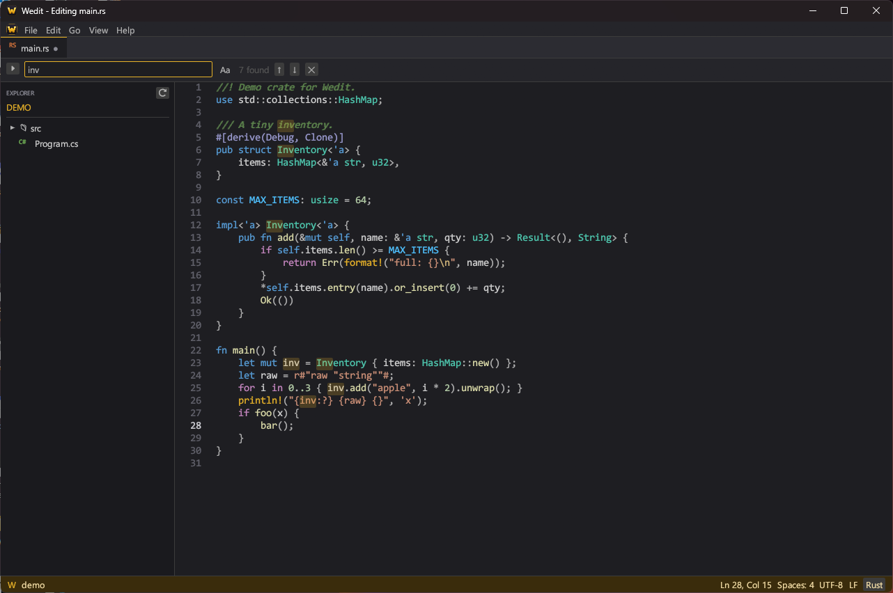

<div align="center">


# Wedit

**A fast, lightweight code editor for Rust and C#, written entirely in Rust.**




</div>

---

Wedit is a desktop code editor in the spirit of Sublime Text and VS Code. It starts instantly, ships as a single
~4 MB executable, and focuses on two languages: **Rust** (`.rs`) and **C#** (`.cs`).
The title bar always shows the file you're working on: `Wedit - Editing main.rs`.

## ✨ Features

### Editing
- **Syntax highlighting** for Rust and C# from hand-written lexers. It covers keywords, types, functions, macros,
  lifetimes, attributes, raw/verbatim/interpolated strings, escape sequences, nested block comments,
  doc comments and preprocessor directives.
- **Smart typing:** auto-indent, block expansion when you press Enter after `{`, and auto-closing brackets and quotes
- **Line tools:** toggle comment, duplicate line, move line up/down, indent and outdent selections
- Line numbers, current-line highlight, word wrap, and zoom

### Navigation
- **Tabs** with unsaved-change indicators, middle-click to close, and prompts before losing work
- **Explorer sidebar:** open a folder and browse it
- **Quick Open (`Ctrl+P`):** fuzzy search across every file in the folder
- **Find & Replace** with match highlighting and match counts
- **Go to Line** (supports `line:column`)

### Quality of life
- Dark and light themes with gold accents
- Keeps CRLF/LF line endings and handles UTF-8 BOMs
- Drag and drop files or folders onto the window
- Restores your last folder and open files on startup
- Open files from the command line: `wedit path\to\file.rs` or `wedit path\to\folder`

## ⌨️ Keyboard shortcuts

| Action | Shortcut |
| --- | --- |
| New / Open file / Open folder | `Ctrl+N` / `Ctrl+O` / `Ctrl+Shift+O` |
| Save / Save as | `Ctrl+S` / `Ctrl+Shift+S` |
| Close tab / Next tab / Previous tab | `Ctrl+W` / `Ctrl+Tab` / `Ctrl+Shift+Tab` |
| Quick Open (go to file) | `Ctrl+P` |
| Find / Replace | `Ctrl+F` / `Ctrl+H` |
| Next / previous match | `F3` / `Shift+F3` |
| Go to line | `Ctrl+G` |
| Toggle comment | `Ctrl+/` |
| Duplicate line | `Ctrl+Shift+D` |
| Move line up / down | `Alt+↑` / `Alt+↓` |
| Indent / Outdent | `Tab` / `Shift+Tab` |
| Undo / Redo | `Ctrl+Z` / `Ctrl+Y` |
| Toggle Explorer | `Ctrl+B` |
| Toggle word wrap | `Alt+Z` |
| Zoom in / out / reset | `Ctrl+=` / `Ctrl+-` / `Ctrl+0` (or `Ctrl+Mouse wheel`) |

## 📦 Installation

Download `Wedit-Setup-1.0.0.exe` from the Releases page and run it.

The installer:
- installs just for your Windows account, so it **doesn't need admin rights** (`%LOCALAPPDATA%\Programs\Wedit`)
- can create Start Menu and Desktop shortcuts
- can add **Edit with Wedit** / **Open folder in Wedit** to the Explorer right-click menu
- can register Wedit as an editor for `.rs` and `.cs` files
- can add Wedit to your `PATH`
- registers an uninstaller under **Settings → Apps**

To install or uninstall without a window:

```bash
Wedit-Setup-1.0.0.exe --quiet
```

```bash
"%LOCALAPPDATA%\Programs\Wedit\uninstall.exe" --uninstall --quiet
```

Prefer not to install? `wedit.exe` is fully portable. Just run it.

## 🔨 Building from source

**Requirements:** a [Rust toolchain](https://rustup.rs) (stable, MSVC) and the Windows SDK. The SDK provides
`rc.exe`, which embeds the icon and is installed with the Visual Studio C++ build tools.

```bash
git clone https://github.com/wedit-team/wedit.git
```

```bash
cd wedit
```

```bash
powershell -ExecutionPolicy Bypass -File build.ps1
```

`build.ps1` regenerates the icon, runs the tests, and builds both binaries into `dist/`:

```
dist/
├── wedit.exe               # the editor
├── Wedit-Setup-1.0.0.exe   # the installer (with wedit.exe embedded)
└── wedit.ico
```

Common development commands:

```bash
cargo run -p wedit
```

```bash
cargo test -p wedit
```

> The installer embeds `target/release/wedit.exe` at compile time, so build the editor in release mode
> (`cargo build --release -p wedit`) before building `wedit-installer`. `build.ps1` handles that order for you.

## 🗂️ Project structure

```
wedit/
├── assets/                  # Generated icon (ico/png/rgba) and README images
├── crates/
│   ├── wedit/               # The editor (egui / eframe)
│   │   └── src/
│   │       ├── app.rs       # Window, tabs, sidebar, dialogs, status bar
│   │       ├── syntax.rs    # Rust & C# lexers
│   │       ├── editing.rs   # Smart-edit operations (indent, comment, move…)
│   │       ├── document.rs  # File loading/saving, line endings
│   │       ├── explorer.rs  # Folder tree + fuzzy file index
│   │       └── theme.rs     # Dark/light palettes and syntax colours
│   ├── wedit-installer/     # Self-contained Rust installer & uninstaller
│   └── icon-gen/            # Draws the golden "W" icon with tiny-skia
├── build.ps1                # One-step release build
└── Cargo.toml               # Workspace
```

## 🛣️ Roadmap

- [ ] Language Server Protocol support (rust-analyzer, OmniSharp/Roslyn) for completions and diagnostics
- [ ] Incremental highlighting for very large files
- [ ] Multiple cursors
- [ ] Integrated terminal
- [ ] More languages

## 🧰 Built with

- [egui / eframe](https://github.com/emilk/egui): immediate-mode GUI
- [rfd](https://github.com/PolyMeilex/rfd): native file dialogs
- [tiny-skia](https://github.com/RazrFalcon/tiny-skia): icon rendering
- [winreg](https://github.com/gentoo90/winreg-rs) and [mslnk](https://crates.io/crates/mslnk): installer integration
